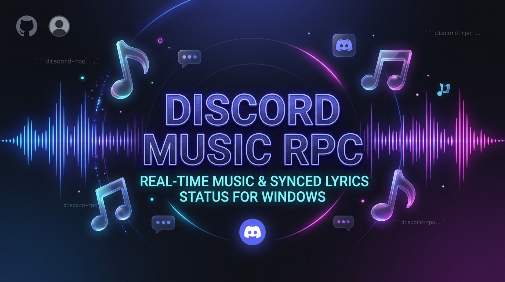
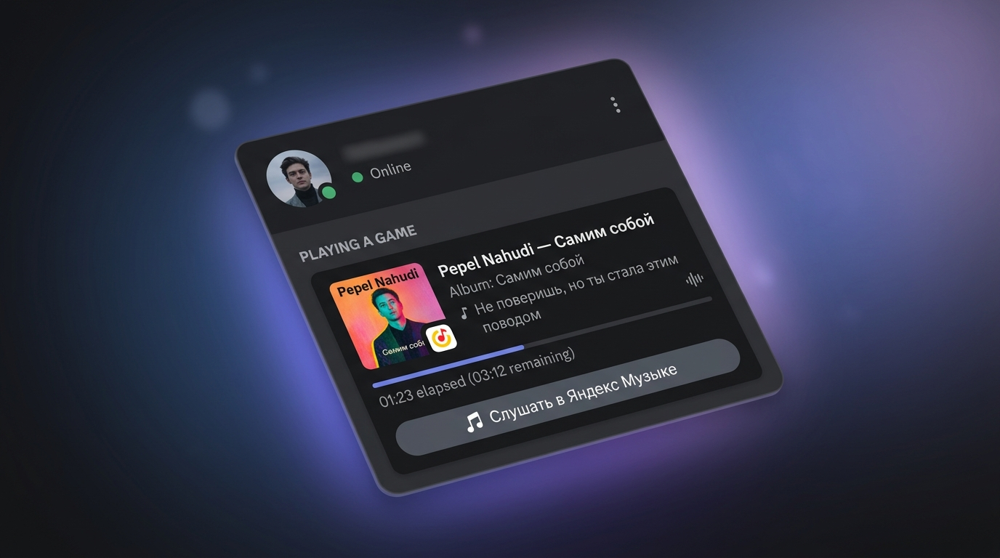
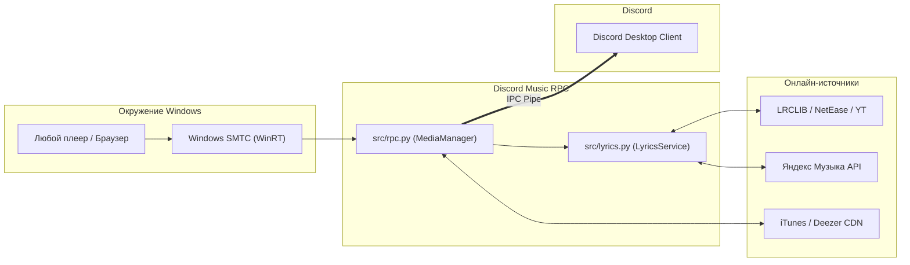

<p align="center">
  
</p>

<h1 align="center">🎵 Discord Music RPC</h1>

<p align="center">
  <strong>Трансляция текущей музыки с синхронизированными строками текста (LRC) прямо в статус Discord для Windows 10/11</strong>
</p>

<p align="center">
  <a href="https://www.python.org/"></a>
  <a href="https://www.microsoft.com/windows/"></a>
  <a href="https://discord.com/"></a>
  <a href="LICENSE"></a>
  <a href="#️-сборка-exe"></a>
</p>

<p align="center">
  <a href="#-возможности">✨ Возможности</a> •
  <a href="#-интерфейс">📸 Интерфейс</a> •
  <a href="#-быстрый-старт">🚀 Быстрый старт</a> •
  <a href="#️-настройка-configjson">⚙️ Настройка</a> •
  <a href="#️-сборка-exe">🛠️ Сборка EXE</a> •
  <a href="#-поддерживаемые-плееры">🎧 Плееры</a> •
  <a href="#-частые-вопросы-faq">❓ FAQ</a>
</p>

---

## 📸 Интерфейс

<p align="center">
  
</p>

> [!NOTE]
> Приложение использует нативный системный механизм **Windows System Media Transport Controls (SMTC)** — тот же самый, который выводит компактный плеер при изменении громкости в Windows. Поэтому оно подхватывает треки из любого браузера или плеера **без сторонних расширений**.

---

## ✨ Возможности

- 🎤 **Синхронизированные слова песен (Synced LRC)**:
  - Автоматический поиск текста в режиме реального времени через [LRCLIB](https://lrclib.net), YouTube Music, NetEase и Яндекс Музыку.
  - Строчки песни сменяются в статусе синхронно с воспроизведением трека.
  - Умная эвристика (Intro/Outro estimation), если у трека есть только обычный текст без таймкодов.
- 🖼️ **Автоматическая загрузка обложек**:
  - Высококачественные обложки альбомов (Apple iTunes / Deezer / Яндекс Музыка).
- ⏱️ **Таймкоды и прогресс-бар**:
  - Отображение текущего прогресса воспроизведения: сколько прошло и сколько осталось до конца.
- ⏯️ **Умное отслеживание статуса**:
  - При паузе появляется статус ⏸ с сохранением позиции.
  - При остановке воспроизведения или закрытии плеера статус аккуратно скрывается.
- 🔗 **Интерактивные кнопки**:
  - Кнопка «Слушать трек» со ссылкой на поиск песни в один клик.
- 📦 **Полная автономность**:
  - Готовый бинарник `.exe` не требует установленного Python и сторонних пакетов.
  - Локальный оффлайн-кэш текстов в папке `lyrics/`.

---

## 🎧 Поддерживаемые плееры

Благодаря интеграции через WinRT / SMTC приложение работает «из коробки» со всеми источниками звука:

| Плеер / Сервис | Источник | Отображение обложки | Текст песни (LRC) |
|---|---|:---:|:---:|
| **Яндекс Музыка** | Веб-версия / Десктопное приложение | ✅ HD | ✅ Родной каталог + LRCLIB |
| **YouTube / YouTube Music** | Chrome, Edge, Brave, Opera, Firefox | ✅ iTunes / Deezer | ✅ LRCLIB / YouTube |
| **Spotify** | Официальное приложение Windows / Веб | ✅ iTunes / Deezer | ✅ LRCLIB / NetEase |
| **Apple Music / iTunes** | Приложение из Microsoft Store / Win32 | ✅ Официальная | ✅ LRCLIB |
| **AIMP / foobar2000 / VLC** | Десктопные плееры (с включенным SMTC) | ✅ По метаданным | ✅ LRCLIB / Локальный .lrc |
| **SoundCloud / VK Музыка** | Любой поддерживаемый браузер | ✅ По названию | ✅ LRCLIB |

---

## 🚀 Быстрый старт

Выберите удобный вариант запуска:

### Вариант 1: Исполняемый файл `.exe` (Рекомендуется)
> Установка Python не требуется!

1. Скачайте архив со сборкой или скомпилируйте файл [`dist\DiscordMusicRPC.exe`](dist/DiscordMusicRPC.exe).
2. Скопируйте файл [`config.example.json`](config.example.json), переименуйте его в `config.json` и укажите ваш `client_id` ([как получить](#️-настройка-configjson)).
3. Запустите **`DiscordMusicRPC.exe`** (или дважды кликните по `dist\DiscordMusicRPC.exe`).

### Вариант 2: Запуск из исходного кода (`src`)
> Требуется Python 3.10 или новее.

1. Клонируйте репозиторий:
   ```bash
   git clone https://github.com/<your-username>/discord-rpc-music.git
   cd discord-rpc-music
   ```
2. Установите зависимости:
   ```cmd
   install.bat
   ```
   *(или вручную: `pip install -r requirements.txt`)*
3. Скопируйте `config.example.json` в `config.json` и укажите `client_id`.
4. Запустите:
   ```cmd
   start.bat
   ```
   *(или `python main.py`)*

---

## ⚙️ Настройка (`config.json`)

<details open>
<summary><b>1. Получение Client ID в Discord (2 минуты)</b></summary>
<br>

1. Перейдите на портал разработчиков: [Discord Developer Portal](https://discord.com/developers/applications).
2. Нажмите **New Application** в правом верхнем углу.
3. Введите название приложения (например, `Музыка` или `Music`) и нажмите **Create**. *(Именно это название будет отображаться жирным шрифтом в статусе Discord)*.
4. В левом меню откройте вкладку **OAuth2** (или **General Information**).
5. Нажмите **Copy** возле поля **Application ID** (Client ID).
6. Вставьте полученный ID в `config.json` в поле `client_id`.
</details>

<details>
<summary><b>2. Токен Яндекс Музыки (Необязательно, для официальных текстов)</b></summary>
<br>

Токен даёт доступ к оригинальным текстам песен и официальным обложкам из базы Яндекса (актуально для треков русскоязычных исполнителей, которых нет на LRCLIB).

1. Откройте в браузере сайт [music.yandex.ru](https://music.yandex.ru) и авторизуйтесь.
2. Нажмите `F12` (Инструменты разработчика) → вкладка **Network (Сеть)**.
3. Включите любой трек.
4. В поле фильтра введите `api.music.yandex` и кликните по любому запросу.
5. В блоке **Request Headers** найдите заголовок `Authorization: OAuth y0_...`.
6. Скопируйте часть, начинающуюся с `y0_...`, и вставьте в `config.json` в поле `yandex_token`.
</details>

<details>
<summary><b>3. Собственные тексты песен (.lrc)</b></summary>
<br>

Если нужного текста нет в открытых базах, вы можете добавить его вручную:
1. Создайте текстовый файл в формате `Исполнитель - Название.lrc`.
2. Поместите его в папку [`lyrics/`](lyrics/) (например, `lyrics\Pepel Nahudi - Самим собой.lrc`).
3. Приложение мгновенно подхватит его во время воспроизведения этого трека!
</details>

### Параметры конфигурационного файла

```json
{
  "_readme": "Вставь в client_id свой Application ID с https://discord.com/developers/applications",
  "client_id": "1566476641201430528",
  "show_time": true,
  "show_button": true,
  "show_images": true,
  "show_lyrics": true,
  "lyrics_estimate": true,
  "yandex_token": "",
  "refresh_interval": 2
}
```

| Параметр | По умолчанию | Описание |
|:---|:---:|:---|
| `client_id` | `""` | **Обязательно.** Application ID Discord-приложения |
| `show_time` | `true` | Отображение прогресса трека (прошло / осталось) |
| `show_button` | `true` | Отображение кнопки со ссылкой на поиск трека |
| `show_images` | `true` | Загрузка и показ обложки альбома |
| `show_lyrics` | `true` | Отображение синхронизированной строчки текста по таймкодам |
| `lyrics_estimate` | `true` | Приблизительная синхронизация при отсутствии LRC разметки |
| `yandex_token` | `""` | Токен Яндекс Музыки (для текстов и обложек русских треков) |
| `refresh_interval`| `2` | Период опроса медиа-сессий Windows в секундах |

---

## 🛠️ Сборка EXE

В репозиторий включен готовый скрипт сборки на базе PyInstaller:

```cmd
build.bat
```

Что делает скрипт:
- Автоматически упаковывает Python-код, модуль `winsdk` со всеми C++/WinRT библиотеками, `pypresence` и `requests` в один компактный переносимый файл.
- Сохраняет результат в папку **`dist\DiscordMusicRPC.exe`**.

> [!TIP]
> Скомпилированный `.exe` автоматически умеет брать `config.json` как из текущей папки, так и из родительской, если запускается прямо из папки `dist`.

---

## 🏗️ Архитектура проекта



---

## 📁 Структура репозитория

```text
discord-rpc-music/
├── assets/
│   ├── banner.jpg         # Баннер для репозитория
│   └── preview.jpg        # Скриншот-превью интерфейса
├── src/
│   ├── __init__.py        # Инициализация пакета
│   ├── main.py            # Точка входа в приложение
│   ├── rpc.py             # Ядро SMTC и интеграция с Discord RPC
│   └── lyrics.py          # Модуль фонового поиска и кэширования текстов
├── lyrics/                # Папка для локальных и кэшированных текстов (.lrc)
├── dist/                  # Скомпилированный .exe файл
│   └── DiscordMusicRPC.exe
├── config.example.json    # Шаблон конфигурации для GitHub
├── config.json            # Локальный файл настроек (в .gitignore)
├── main.py                # Лаунчер корня репозитория
├── rpc.py                 # Алиас совместимости
├── build.bat              # Скрипт сборки автономного .exe
├── install.bat            # Установка Python-зависимостей
├── start.bat              # Запуск из исходников
├── requirements.txt       # Зависимости проекта
├── LICENSE                # Лицензия MIT
└── README.md              # Документация проекта
```

---

## ❓ Частые вопросы (FAQ)

<details>
<summary><b>1. Статус в Discord не появляется при запуске</b></summary>
<br>

- Убедитесь, что приложение Discord запущено на компьютере.
- Проверьте, включен ли в настройках Discord пункт: **Настройки пользователя** → **Конфиденциальность активности** → **Отображать текущую активность в статусе**.
- Проверьте корректность `client_id` в `config.json`.
</details>

<details>
<summary><b>2. Музыка играет в браузере, но статус не меняется</b></summary>
<br>

- Нажмите клавиши громкости на клавиатуре: отображается ли оверлей Windows с кнопками Play/Pause и названием трека?
- Если нет: в Chrome/Edge перейдите по адресу `chrome://flags` (или `edge://flags`), найдите флаг **Hardware Media Key Handling** и переведите его в положение **Enabled**.
</details>

<details>
<summary><b>3. Как отключить показ текста песни и оставить только название?</b></summary>
<br>

- Откройте `config.json` и установите `"show_lyrics": false`.
</details>

---

## 📄 Лицензия

Проект распространяется под открытой лицензией [MIT License](LICENSE). Вы можете свободно использовать, модифицировать и распространять данный проект.
